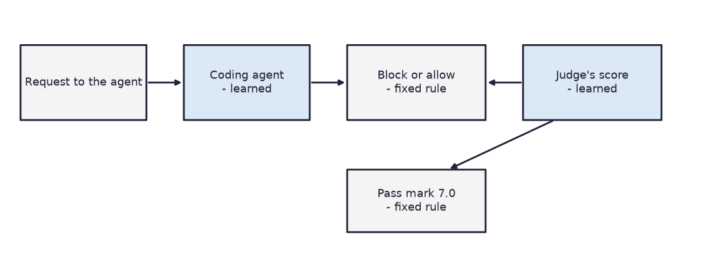
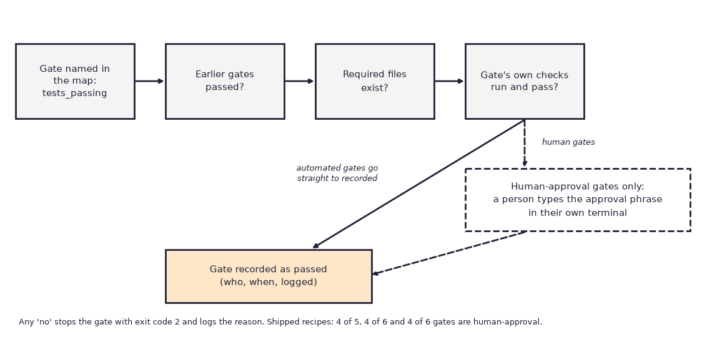
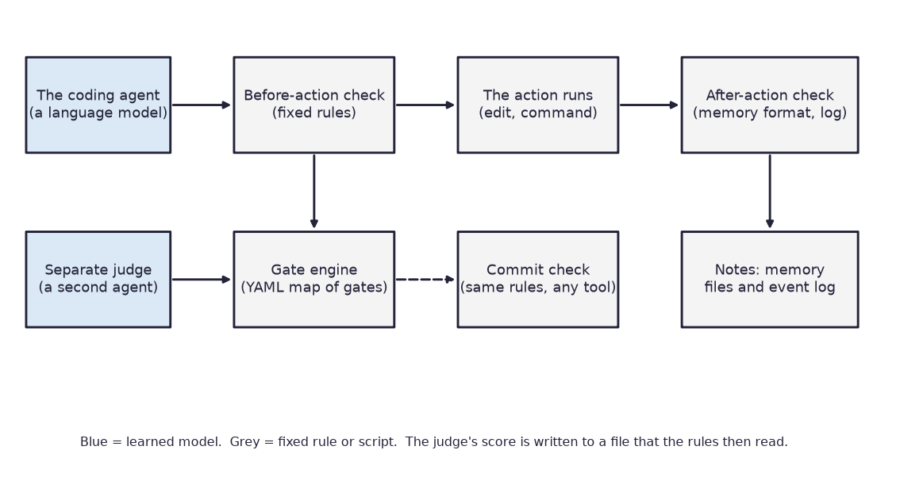
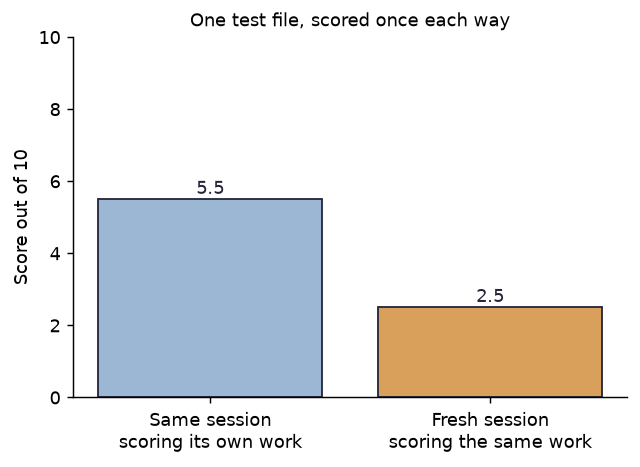

# Meridian

*A set of scripts and rules that sit around an AI coding agent and refuse to let it say "done" until the work has passed checks it cannot talk its way past.*

Status: a working prototype (version 0.1.0), last changed in October 2026. Code: https://github.com/PCSchmidt/meridian (public; the README says MIT licence, but the repository has no LICENSE file yet). It has no users that I can show and no releases on GitHub.

I built Meridian because of a habit I noticed in AI coding agents. Partway through a long project they start announcing that features are finished when the tests have not run, and each new work session forgets what was decided in the last one. Meridian puts a checkpoint system around the agent. A checkpoint cannot be passed by saying it was passed: a small program has to confirm it, and for some checkpoints a person has to approve it. AI coding agents wrote almost all of the code, while I directed the scope, plan, architecture and preferences. It is a tool for developers, not a product for end users. If you are short of time, the chapter for recruiters and interviewers is near the end, and the results chapter is the one that says how much to believe.

Think of a building inspector. A builder who says "the wiring is fine" is not enough. The inspector checks, and the builder cannot move on to the plaster until the inspection is signed. Meridian tries to be that inspector for an AI agent. The comparison breaks down in one place that matters: the inspector in Meridian is partly another AI agent, and the rules that agent's findings feed into have gaps, which I describe in the testing chapter.

Here is what is fixed and what is learned. A calculator is deterministic: the same input always gives the same answer. A weather forecast is probabilistic: it is a best guess that can be wrong. Meridian is a mixture. The scripts are deterministic. They include the gate engine (the program that decides whether a checkpoint may be marked passed), the list of dangerous commands to block, the checks on the notes the tool keeps, the pass-mark arithmetic and the check that runs when work is saved. They are ordinary shell scripts, meaning small programs written in the plain command language of Linux and Git Bash, and they give the same output for the same input. The learned parts are the AI agents around them. The coding agent that does the work, and the separate judge agents that score it, are language models (software trained on huge amounts of text). What they do depends on that training, they can be wrong in ways nobody wrote down, and their scores are opinions, not measurements. Chance enters in two places: a language model's wording and scoring can differ from one run to the next, and the project's one headline experiment was run only once.

To keep the learned parts in check, the project does four things. A judge must write its result in a fixed file format, and a fixed pass mark of 7.0 out of 10 decides what happens next. Blocking decisions are made by scripts, not by a model's opinion. A person must approve certain checkpoints. And the same checks run again when work is saved to git (the version-control tool that records every change to a project), whichever AI tool wrote it.



The single experiment behind the project is small. An agent that graded its own deliberately bad code gave it 5.5 out of 10, and a fresh agent that had not written it gave 2.5. That is one example, not a benchmark, and I treat it that way below.

In short, Meridian is a rule-based checkpoint system for AI coding agents, with one small supporting experiment and several honest gaps.

## What problem this solves

Suppose you ask an AI coding agent to build a web app over several weeks. At first it goes well. Then, around the point where the work is two-thirds done, trouble starts. The agent says "all tests pass" without running them. It marks a feature complete although three odd cases were skipped. It scores its own code generously, even code with serious security holes. When you open a new session, the agent has forgotten that you chose one login method two sessions ago and may choose a different one. Its time estimates are guesses that are never compared with what actually happened. And when something goes wrong, there is no record of what the agent did.

The README lists five such failures: false claims of completion, lost context, silent drift from the original scope (the written agreement about what is and is not being built), estimates that never improve, and no visibility. Most people cope by reading everything the agent produced and asking it to be honest. The README argues this is not a wording problem and answers with structure: scripts that check, logs that record, and a second reader who did not write the work.

Similar tools exist. The project's notes name Syntaris, the open framework Meridian began from, and other harnesses. A harness is the surrounding machinery that runs an agent, gives it tools and limits what it may do. I did not survey these tools, so I do not claim Meridian is better. The README says what it adds: a checkpoint list you can reshape, notes kept in a strict format, an independent judge, and a written list of the assumptions each rule encodes. It also says where Meridian is the wrong tool: one-off scripts, single-session projects, and teams unwilling to write down scope first.

The goal is that a model cannot declare a checkpoint passed falsely, that context survives a restart, and that a failure can be traced afterwards. Success is measured today by a test suite, one experiment comparing self-scoring with independent scoring, and two projects built with Meridian installed. Better time estimates over the long run are a hope, not a result.

Meridian deliberately does not write code, replace a person's judgment on scope, security or release, or promise a reliable agent. Its limits say public and unclassified material only. A skeptic would ask, "Why not just write good instructions for the agent?" The fair answer is that instructions can be ignored, while a program's exit code cannot be argued with. An exit code is the number a program hands back when it ends: 0 means all is well and any other number means something failed. The weaker half of the answer is that Meridian only checks what someone wrote a check for.

In short, the project tackles a real and recognisable problem in long AI-assisted builds, and it answers with structure rather than better wording.

## Where the project came from

Meridian began as a fork, a copy that is then changed on its own, of Syntaris, an agent framework by another person, brianonieal. The demo guide calls that author a fellow JHU (Johns Hopkins University) student. The README's acknowledgments say Meridian builds on Syntaris for its checkpoint enforcement, note types and recipe layout. It also credits Anthropic's engineering writing on harnesses, the Reflexion paper (a 2023 research paper on letting a model write notes on its own mistakes), and Martin Fowler's writing on harness engineering. The architecture record quotes my complaint about the original: "There is no feedback that I'm aware of." That sentence explains the project's main addition, which is a log engineers can search.

The first commit, a saved set of changes in git, was on 26 May 2026 and holds architecture decisions. Two days later the experiment described below was run, before any scripts were built.

The technical overview calls Meridian the source of a wider group of my repositories, and says plainly that the siblings do not all import its code. Two of those sibling projects come up later. VERA is my research-assistant project that takes a topic and produces a cited write-up, and it was the one full trial of Meridian. Hard Power Intelligence is my intelligence-analysis website, and AeroIntel is an existing production app of mine; the notes report Meridian being tried on both.

In short, Meridian is a rebuilt and extended descendant of someone else's framework, and its documents say so.

## What it does, step by step

Meridian is installed into a project once. After that it works in six steps, which I will follow through one small example, the project's own recipe for command-line tools.

First, I write two plain documents: a contract (what is being built, what is out of scope, how I will know it is done) and a spec (the list of features, in priority order). Second, I describe the checkpoints, which Meridian calls gates. A gate is a named checkpoint, such as "tests are passing", that must be cleared before work moves on. The gate list lives in a settings file written in YAML (YAML Ain't Markup Language, a plain-text format for structured settings), and it says which gates must come before which. The command-line recipe runs from "scope confirmed" to "commands approved" to "tests passing" to "package ready".

Third, the agent works toward the current gate. Say it reaches "tests passing" and announces it is done. I ask the gate engine to mark the gate passed. Fourth, the engine checks, in order, that the earlier gates passed, that the required files exist, and that the gate's own checks, small scripts, run and succeed. If the test runner fails, the engine stops with exit code 2 and writes the reason into a log. The gate stays closed. Saying it passed changes nothing.



Fifth, for a quality gate, a separate judge agent reads the work without having produced it and writes a score. Sixth, when the work is saved to git, the same checks run again, and at the start of the next session the agent is handed the current gate and the saved notes.

A gate that needs a human works differently. A person has to type an approval phrase, for example "DATA CONTRACT APPROVED", in their own terminal. On Claude Code, the AI tool whose hook system Meridian is built on, a hook (a small script that runs just before or after each action the agent takes) refuses to let the agent type that command. The engine then records who approved and when.

After each gate a short note, called a reflexion entry, records the hours predicted, the hours taken, and why they differed; the next session reads it. Each feature is also tracked through five stages (works on the happy path, which means the normal case with nothing going wrong; works with other parts; handles odd cases; handles errors; is hardened), so "90 percent done" can be told apart from "done".

The intended user is a developer who builds with an AI agent over many sessions and is willing to write scope documents first. The user types short commands such as "/start" and "/health" in the agent's chat and reads plain text reports. A human decides scope, approves human gates, and chooses whether to commit.

Use in a government or defense setting would need more work: the record of who approved a gate is just the name configured in git, and the project's notes admit approvals can be forged by editing files by hand.

In short, Meridian turns "the agent says it is done" into "the scripts say it is done, and here is the log".

## The parts, the data and the rules

Meridian is shell scripts and shell test scripts, with no program in any other language. The easiest way to meet its parts is to follow one agent action through the diagram below.



Say the agent decides to run a command. Before it does, the before-action hook fires. This script consults the blocklist, a list of text patterns: a command that matches a "block" pattern is stopped, and one that matches a "warn" pattern is allowed but logged. The hook also refuses attempts to write the file that records which gates have passed. If the command goes ahead, the after-action hook checks that any notes the agent wrote have the right format and adds a line to the event log. When the agent then asks to pass a gate, the gate engine does the checking described earlier. If the gate wants a judgment, the engine calls for one of three judge agents: one scores a gate, one looks for drift (work wandering away from the agreed scope), and one reviews the spec for gaps and contradictions. A small verdict checker reads the judge's written result and applies the pass mark. Finally, at commit time, a portable verifier runs the same engines through git or through the project's CI (continuous integration, an automatic test runner that fires when code is uploaded), so a change made in any editor meets the same checks.

Around this core sit three recipes, which are ready-made gate lists for web apps, command-line tools and machine-learning projects, and fifteen skills, short instruction files the agent loads only when asked.

Several rules are meant never to break. A gate cannot be marked passed unless its earlier gates passed, its required files exist, and its checks ran and succeeded. A gate that names a check which is not installed is blocked rather than skipped, unless a setting asks for skipping. A human-approval gate needs an approval phrase typed by a person. The agent may not write the gate state file directly. A note must match its format. A commit is refused if a human gate is marked passed without an approval record. I tried to break several of these; the testing chapter reports what happened.

The data is small and entirely created by the tool itself. The gate list is a YAML file. Gate state is a JSON file (JavaScript Object Notation, a plain-text format for structured data) listing passed gates. The event log is a JSONL file (JSON Lines, one JSON record per line) with eight kinds of event, among them session start and end, gate passed, gate blocked, evaluator verdict and error. Memory is three files: patterns seen more than once, a log of session events, and the estimate notes. A toy example of one estimate note: predicted 10 hours, actual 4, so the ratio is 2.5, with a written cause such as "design was settled in advance". The runtime files are kept out of git, so a fresh copy of the repository starts with none of the author's history.

Everything lives in files, not a database. Two helper programs, jq (a tool for reading JSON) and yq (the same for YAML), are needed. When they are missing, the installation check marks it critical, but some checks fail open, meaning they quietly allow the action instead of stopping it. The gate engine's "can this gate proceed" question is one of these. The weakest link is that an agent can still write files the rules trust, described under shortcomings.

In short, Meridian is a pile of small scripts reading and writing plain files, and its trust rests on which files the agent is and is not allowed to touch.

## The methods and the arithmetic

There is little mathematics here. Nothing is trained, and no formula matters beyond arithmetic anyone can do by hand. These are the methods that matter.

**Checking the gate list for loops.** The gate list is a DAG (Directed Acyclic Graph), meaning a set of steps with one-way dependencies and no loops. The engine looks for loops with a depth-first search: it follows each chain of "requires" as far as it goes, remembering the path it is on, and if it meets a gate already on its path it reports a cycle. Toy example: gate A requires B and B requires A. Starting at A, the search goes to B, then back to A, which is on the path, so it reports "Cycle: A to B". Without this check, neither gate could ever open. I confirmed the check catches that loop. It does not catch a gate that requires a name that does not exist, which I describe later.

**The judge's score.** The gate judge rates work from 0 to 10 on four things: whether it is complete, its quality, whether it is consistent with the contract and spec, and whether it meets what this gate asks. The overall score is a weighted average, with completeness counting 0.30, quality 0.25, consistency 0.20 and gate fit 0.25. Take my own numbers: completeness 6, quality 5, consistency 8, gate fit 4. Then the overall score is 1.8 + 1.25 + 1.6 + 1.0 = 5.65, rounded to 5.7. The judge's prompt says 7.0 or more with no high-severity issue is a pass, 5.0 or more is a warning, and anything lower or any high-severity issue is a fail. So 5.7 is a warning. The checking script then applies its own bar: any score under 7.0 blocks the gate, so a warning at 5.7 still blocks. The weights are the author's choice, written in the prompt; no document says why these numbers.

**Two completion numbers.** For each feature, the tracker holds five true-or-false stages. The report gives two percentages: the share of features that work on the happy path, and the share that pass all five stages. If 12 of 13 features work normally but none has had its odd cases and errors handled, the report says 92 percent and 0 percent. The gap between the numbers is the signal.

**Estimate ratio.** Predicted hours divided by actual hours: predicted 10, actual 4 gives 2.5. The roadmap itself says its recorded figures are not evidence that estimates improve.

**Blocklist matching.** Each rule is a regular expression, a compact way to describe matching text. Deterministic dangerous patterns, such as deleting everything under the root folder or an Amazon access key in a file, block. Looser patterns, such as SQL built by gluing strings together, only warn, because they would fire too often if they blocked. The cost is that a pattern only catches the forms it was written for.

In short, the arithmetic is a loop check, a weighted average, two percentages and a ratio, each small enough to check by hand.

## The models and what they do

Meridian trains no model and contains no model weights (the learned numbers inside a model). It uses language models in two roles, and it names none of them in its own code.

The first is the coding agent: the AI tool that edits files and runs commands. Meridian is built around Claude Code, Anthropic's command-line coding agent, because the project's notes say only Claude Code offers a before-action hook that can stop an action. 49 of the 60 commits carry a credit line naming Claude models (Opus and Sonnet versions, as spelled there); the repository does not say which model did which task. The rules also generate guidance files for the editors Cursor, Windsurf and Cline and a general file for tools such as Aider or Codex, all of which are other AI coding tools. Those cannot block an action, so for them the guidance is a request and the commit check is the real barrier.

The second role is the three judge agents. Each is a prompt file that a coding agent loads as a separate helper with a fresh conversation. The gate judge takes in a gate name, a list of files and the contract and spec, and gives back a verdict in JSON: four scores, an overall score, issues marked high, medium or low, and pass, warn or fail. Its prompt says it did not produce the work and must not praise or soften findings. The drift judge reads the spec and feature tracker and returns an alignment score from 0 to 10; below 5 means "drifted", below 7 "warn". It is advisory, meaning it warns but does not block, unless a setting turns blocking on. The spec reviewer checks the spec for gaps and contradictions. No file says which language model should run them, so it depends on what the coding agent uses.

Why these choices? The coding agent is Claude Code because of the hook system, and the judge is a separate agent because of the experiment. No document gives a reason for the prompt wording or the weights. Alternatives include rules in a single prompt (cheap, but ignorable), fixed tests only (blind to scope drift), and a human reviewer (best, but slow). The judge costs extra model use on each gate, and the project does not record how much.

What does the judge get wrong? The repository has few real examples. In the calibration test it separated three hand-built projects cleanly. On the AeroIntel app, the drift judge flagged one stale tracking entry with no false alarms recorded. The roadmap says earlier installs on that app had non-working hooks because the installer never copied the scripts, so I cannot tell whether that run had the hooks active. Those are the project's reports; the projects are not here. The judge is a language model, so it can vary between runs and can be swayed by a long, confident-looking report.

The safeguards around the judges are fixed. The verdict must be valid JSON with a score and verdict. A missing, malformed or low-scoring verdict blocks. The pass mark is applied by a script. For human-approval gates, a script refuses to pass the gate without an approval phrase, and on Claude Code the agent is blocked from typing it. For all other gates, a person is not required.

One gap matters most. Nothing proves that the verdict file came from a separate judge. The script checks that the file exists and has the right numbers, not who wrote it. A coding agent that writes its own verdict file would pass. I tested this: a file claiming a score of 9 and a verdict of pass was accepted. The separation is therefore a working agreement enforced by the file format, not a cryptographic guarantee, meaning not something that is mathematically impossible to fake. The project's notes call the evaluator step a "contract" and say a shell script cannot start a helper agent itself, so I read this as a known boundary, but the documents do not mention the forgery case.

A fixed test run already catches failing tests without any model. The judge adds value only for things no test covers, such as scope drift.

In short, Meridian adds no model of its own: a coding agent does the work, a second agent scores it, and fixed scripts decide what the score means.

## Testing, edge cases and attacks

Meridian's tests are shell scripts in twenty files. Most are what the questionnaire calls integration tests: they build a small fake project in a temporary folder, run the real scripts against it, and check exit codes and output. A few are end-to-end tests that run the whole path, such as one that makes a real git commit and checks that a failing verification rejects it. There are no property tests, which try many random inputs, and no timing tests. Nothing here is evaluation in the sense of measuring quality on unseen examples, apart from the calibration cases I describe in the results.

I ran all twenty files from a scratch copy with the home folder pointed at an empty folder. Fifteen files passed completely, for 224 passing checks. Five had failures: the health report test (8 of 12), the first integration test (8 of 9), the second integration test (16 of 19), and the doctor and status tests (counts not captured). For the health, status and first integration tests the messages were about missing gate and calibration data, which comes from a runtime file that git ignores and a fresh copy lacks. I did not establish the cause for the other two. The README says 240 checks across 18 files, and a commit message says all 20 suites pass. Those are the author's results with runtime files present, so a fresh copy simply does not reproduce them. I could not run the shell-lint tool the README says is clean, because it is not installed. The repository has no CI of its own; the CI workflow exists only as a template for other projects.

I also attacked the rules myself, in a throwaway project, trying fifteen things. The rules held against the main ones. A human-approval gate could not be passed without an approval. A gate with its required files missing was refused. A gate whose check script was not installed was blocked. The agent could not type the approval command, and a normal edit of the gate state file was blocked. A verdict claiming a pass but scoring 3 was blocked by the pass mark, and a commit with a badly formatted notes file was rejected.

Others got through. Writing the gate state file with a quote trick that splits the file name was not blocked. Deleting everything under the root folder was blocked with short flags but not with the long form of the same flags. An agent that wrote its own passing verdict file was accepted. A bad note appended through a shell command was not checked at that moment, and a bad note written through an editor only warned after the fact. The no-verify option on a commit skipped the memory check. And a commit message that merely mentioned the approval command was blocked by mistake.

The gate model document discloses that the agent can still write a script that edits the state file, and that a forged approval would show in the committed difference. The other evasions I did not find disclosed. The undefined-dependency case is a plain defect: a gate that requires a name that does not exist passes the loop check, and the "current gate" answer then says all gates are complete while one remains unpassed. The hooks do nothing in a folder that is not a Meridian project, and several checks fail open when jq or yq is missing.

The tests were written by AI agents. The biggest thing not tested is a live session in which a real agent tries to get around the rules; a manual protocol exists to re-check the hook format after any Claude Code update, and it is not automated.

One piece of history speaks to testing. In the fifth phase the project found that the security hook had never fired in a real session: it read the wrong field names from Claude Code's messages, and the tests had used a shortcut that hid it. The fix and an end-to-end test followed.

In short, the scripts mostly do what they say on the cases they were built for, but a clean copy does not reproduce the author's test counts, and several simple evasions get through.

## Does it work? The results

The project has three pieces of evidence, and each needs its limits stated.

**The self-scoring experiment.** The author wrote a small Python file with eight planted problems, including code that builds database queries by gluing strings together and a hard-coded password. An agent scored it in the same session that made it, and a fresh session scored it again with the instruction "you did not produce this code, do not praise". The first gave 5.5 out of 10 and no blocking advice. The second gave 2.5 and a "do not merge" verdict. There is no accuracy baseline here; the comparison is only between two prompts. The difference of 3.0 points is real for this one file, but the two runs differed in more than separation: the second prompt told the model to be harsh. So the experiment cannot tell how much of the gap comes from independence and how much from the tone of the instruction. It was run once, on one file, with no repeats and no range. The README presents the result as its main finding, and the technical overview more carefully says it motivates separation and is not a universal benchmark. I agree with the second wording.



**The calibration cases.** To test the judges before trusting them, the project built three small fake project states, called fixtures, and had both judge agents score each one. The gate judge gave 8.5 to the aligned project, 3.6 to the one with out-of-scope work, and 5.95 to the one where every feature was only done on the happy path. The drift judge gave 8, 3 and 7. The project concluded the thresholds need no tuning. The cases were made by the author's side, scored in a single session, and number only three, so this shows the judges can tell an obvious case from an obvious problem, not that they would do so on messy real work.

**Real-project use.** The notes report two projects built with Meridian installed. On AeroIntel, the feature tracker showed 100 percent on the happy path and 0 percent through the full lifecycle, and the drift judge found one out-of-date tracking entry. On Hard Power Intelligence, nine gates were reportedly passed in order, and the "brief verified" gate is said to have forced citation checking to be built as real code. These are the project's own reports; those repositories are not here.

A later commit message weakens the nine-gate claim. Setting Meridian up for VERA showed that gates were "largely honour-system", meaning they relied on everyone behaving rather than on enforcement: marking a gate passed ran none of its checks, and twenty recipe check scripts did not exist, so four Hard Power Intelligence gates passed with checks that never ran. The fix landed on 29 September. So the nine gates were recorded as passed, but not all had their checks run.

What did not work: the claimed compliance percentages for other editors were removed because nobody measured them, the first security hook never fired in a real session, and the first installer forgot to copy the scripts. The project reports these itself, which is to its credit.

The planted bugs are the most obvious kind, so the test is easy. I checked thirteen claims from the documents and list them in the companion Evidence Notes: the numbers match their source files, a few claims run ahead of the evidence, and the project's own later commit weakened the one that matters most, that nine gates were enforced.

In short, the evidence shows a clear effect on one test file and a sensible design, but no measurement shows that using Meridian improves a real project.

## Could it be put into real use?

Meridian has never been operated for real users that I can show. It runs on my laptop. The GitHub repository is public, has no stars, no copies, no releases, and two page views in two weeks. The v0.1.0 label exists as a git tag, and the roadmap says publishing a release was deferred. The README says the work is "dogfooded on two production projects", meaning I used my own tool on my own projects, and one of those, Hard Power Intelligence, is described as live at a public address. That project is a separate product, not Meridian, and I did not check it.

On a four-rung readiness ladder (experiment, works locally, deployable, operated), Meridian sits on the second rung: it runs and passes most of its own tests on one machine. It is a toolkit others copy into their projects, so hosting is not the right idea for it.

Against the usual production habits the picture is mixed. The install script worked in my scratch run, but a clean copy fails some of its own tests. Automatic checks block a bad change in projects that install Meridian, but not in Meridian's own repository. Output quality is measured only by the one experiment and three cases. Failure handling is partial: blocks are logged and a missing check script blocks, but several tools fail open when helper programs are missing. People can approve the AI's steps for human-approval gates only. Prompts and settings are versioned in git. Logs are a real strength, with eight event types and a command that lets the operator label each stop as real or false alarm. 

Across the three recipes, 20 of the 25 named check scripts do not ship, and the machine-learning recipe ships none of its eleven, so its gates block until someone writes them. That is safer than silent skipping, but it makes the recipes templates, not working gates.

To deploy it for others it would need a licence file, a tagged release, its own CI, a way to prove who wrote a verdict, and a measured study. Three small steps would help most: add a licence and a release; run the tests in CI on a clean checkout and fix the five failing files; and write a short postmortem (a write-up of what went wrong and why) of the honour-system finding.

As a showcase, I judge Meridian a possible candidate. It matches the applied agentic-workflow family well, since it is about checks, human approval and evaluation of AI output. But it is a tool for developers, has no end users, and hosting it adds nothing a repository does not.

In short, Meridian works on one laptop as a copyable toolkit and should be taken as that.

## Strengths, shortcomings and the work still to do

The strongest points: enforcement rests on exit codes and files, and most of the main blocks held when I attacked them. The project is open about its gaps: it removed unmeasured percentages, recorded two serious bugs, and admits in a commit that its gates were largely honour-system. It logs every block, lets the operator label them, and records why each rule exists and when to retire it.

The shortcomings fall into three kinds. The defects are the undefined-dependency bug, the false block on a commit message that mentions the approval command, the long-flag and quote-trick evasions, and the five test files that fail in a clean copy. The gaps are things left out: no check on who wrote a verdict, no note check on shell appends, no CI of its own, no licence file despite the README's claim, and no measured benefit. The deliberate limits are stated: only Claude Code can block, so the other editors are advised and the commit check does the enforcing; unclassified material only; and no benchmark until others take part.

Three shortcomings matter most. First, the judge's independence is not enforced, yet the headline claim depends on it. Options are a signed verdict, a verdict written only by a script that starts the helper agent, or documenting the limit. I would document it first, then add a cheap check that the verdict file was not written by the coding agent's own editing tool. Second, the headline number is one experiment confounded by prompt tone, meaning two things changed at once and cannot be separated. A fairer test would give several judges the same prompt, same-session and fresh-session, many times, and report a range: small effort, high payoff for credibility. Third, documents run ahead of reality: the "no other framework" claims, the MIT licence line, the nine enforced gates, and the test counts. Correcting wording is a small job.

Promised versus built is mostly good. Gates, memory, the event log, three recipes, the commit check, the drift sensor and docs are built and tested, though the clean-copy failures show some are less solid than the counts suggest. Cost capture is a stub, a placeholder: the schema has token and cost fields, but nothing fills them. A community benchmark and formal release were deferred.

Is it worth finishing? I would tidy and freeze, then run the small honest test: a licence, a tagged release, passing tests on a clean copy, the verdict-author check, and a repeated experiment. Expand only if someone besides me uses it. A careful reviewer would fix the forgeable verdict and approval record first, then the quiet allowing when a helper tool is missing.

In short, the project is honest and mostly sound, its main flaw is that the central claim rests on one soft experiment, and the next step is repair and a better test.

## How it was built, and who did what

AI coding agents wrote almost all of the code, and I directed the scope, plan, architecture and preferences. I did not write the scripts by hand, and I do not claim to have. The repository names the tool: 49 of its 60 commits carry credit lines naming Claude models, its development guide is a Claude Code instruction file, and its architecture notes describe using Claude Code to run the first experiment. Eleven commits carry no credit line (the first eight and three from September), and I do not know whether another tool was involved in them.

The decisions recorded in the architecture notes are: bash only, with Windows instructions; three recipes named for patterns rather than technology stacks; memory in a checked JSON format; testing the judge idea before building it; and reordering the plan so the riskiest parts, the judge and the completion tracker, were tried on a real project first.

How was the AI's work checked? Each gate ended with tests and a written note, but the tests were also written by agents. The history shows the build correcting itself: the hook-format bug, the installer's missing scripts and the honour-system finding were each found and fixed. The commit messages do not say who spotted each problem.

Most of the work landed in two bursts, late May to early June and late July, with small updates since.

In short, I steered and judged and the agents typed, and the history shows a build that found and fixed its own earlier mistakes.

## For recruiters and interviewers

**In thirty seconds.** I directed AI coding agents to build Meridian, a set of scripts that stops an AI coding agent from declaring work finished until checks pass, with a separate judge agent, human approval points and a log. One bad test file scored 5.5 by the agent that wrote it and 2.5 by a fresh judge. **In two minutes**, add that it began as a fork of another person's framework, runs through hooks in Claude Code and through git commits elsewhere, has three recipes, and has about 240 claimed test checks (224 reproduced in my clean-copy run across fifteen files). It has never run for real users.

**What it demonstrates.** Design of AI workflows, with the line drawn between learned and fixed parts. Safety thinking: blocking, approval records and logging. Honest documentation of its own limits. And directing AI tools with written plans. It does not demonstrate operation for real users, teamwork, scale or on-call duty, and it does not show the judge works beyond a small test.

Against typical job requirements the fit is partial in most places, and I would say so plainly.

| Requirement area | Strength | How to say it honestly |
| --- | --- | --- |
| Agent prompts and instructions | Demonstrated | "Written and used; not formally tested." |
| Agentic workflows, evaluation, testing, security | Partly | "Control layer and small tests, not a customer workflow." |
| Deploying and monitoring | Simulated | "Not operated." |

The closest role family is the applied language-model and agentic-workflow engineer, and even that fit is partial because I have not run workflows for customers. Of my current target titles, AI Engineer and Forward Deployed AI Engineer, it fits the first better. The weakest fit is the machine-learning engineer with MLOps (the practice of running models in production), since nothing is trained or monitored in production.

**Likely questions.** *Hardest problem?* Making enforcement hold in a real session: the first hook read the wrong message fields until a test used the real format. *A decision that turned out wrong?* Treating recorded gates as enforced; a later trial showed their checks often never ran, and the engine was changed. *How do you know it works?* Test scripts and attacks; the central experiment is a single run. *What would you change?* Verify who wrote a verdict, repeat the experiment, add CI and a licence. *How would you explain it to an executive?* An inspector for AI-built software: no sign-off without evidence.

**Tough questions.** *Isn't this a wrapper around Claude?* Partly: the agent and judge are language models; the rules around them are the project's own. *If the AI wrote the code, what did you do?* Directed scope, plan and architecture, and accepted or rejected results. *Why believe the numbers?* One run on one file; treat it as motivation. *Have you run it for real users?* No. *What if the input is malicious?* The blocklist catches common destructive forms, I found evasions, and a determined agent could forge a verdict.

**What not to exaggerate.** It is a prototype with one small experiment. The independence of the judge is by agreement, not proof. The second project's gates were not all enforced at first. I did not write the code by hand.

In short, the project shows system design and candid reporting around AI agents, and it does not show production operation.

## Glossary

- **Gate:** a named checkpoint that must be cleared before work moves on.
- **Gate list (DAG, Directed Acyclic Graph):** the set of gates with one-way "must come before" links and no loops.
- **Exit code:** the number a program returns when it ends; 0 means fine, 2 means stop.
- **Hook:** a small script the agent's tool runs just before or after each action.
- **Harness:** the machinery that runs an agent, gives it tools and limits it.
- **Judge (evaluator):** a separate agent that scores work it did not produce.
- **Verdict:** the judge's written result: scores, issues, and pass, warn or fail.
- **Scope:** the agreed list of what is and is not being built.
- **Drift:** work wandering away from the agreed scope.
- **Happy path:** the normal case where nothing goes wrong.
- **Fixture:** a small, made-up test case set up in advance.
- **Fail open:** when a check cannot run, it allows the action instead of stopping it.
- **Honour-system:** relying on everyone to behave, with nothing enforcing it.
- **Recipe:** a ready-made gate list for a kind of project.
- **Reflexion entry:** a short note comparing predicted and actual hours, with a cause.
- **JSON / JSONL (JavaScript Object Notation / JSON Lines):** plain-text formats for structured records.
- **YAML (YAML Ain't Markup Language):** a plain-text format for settings.
- **CI (Continuous Integration):** an automatic test runner that fires when code is uploaded.
- **Dogfooding:** using your own tool on your own projects.

## Where to look in the code

This list is for engineers; other readers can stop here.

```
meridian/
  scripts/        gate engine, commit verifier, memory, telemetry, reports
  .claude/hooks/  before and after action hooks, blocklist, evaluator check
  .claude/agents/ three judge prompts
  .claude/skills/ fifteen slash-command guides
  recipes/        three gate maps with templates
  tests/          20 shell test files and fixtures
  templates/      pre-commit hook and CI workflow copied into other projects
  experiment/     the self-scoring experiment
  docs/           guides and reference
```

Entry points: `install.sh` to install, `scripts/gate-engine.sh` for gates, `scripts/meridian-verify.sh` for the commit check, `.claude/hooks/PreToolUse.sh` for blocking. Needs bash 4, jq, yq and git. The install worked in my scratch run; a clean copy of the tests passes 15 of 20 files. Five files to read first: `scripts/gate-engine.sh`, `.claude/hooks/PreToolUse.sh`, `.claude/hooks/run-evaluator.sh`, `.claude/agents/gate-evaluator.md`, and `experiment/GENERATOR_EVALUATOR_VALIDATION.md`.
