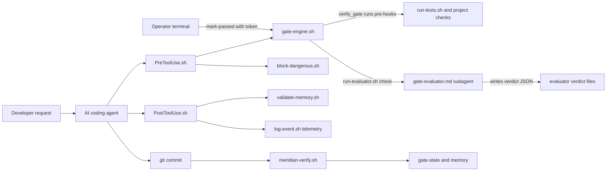
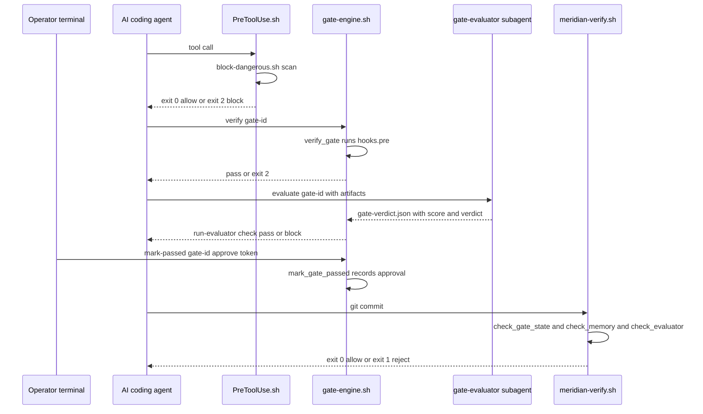

# Meridian - Master Explainer

Repo: <https://github.com/PCSchmidt/meridian> · Live demo: none (DEMO_GUIDE.md walkthrough) · License: MIT claimed in README; no LICENSE file in tree (§24 D3) · Last commit: 2026-09-29 (`7e70722`)
Status: v0.1.0 implementation complete, Phases 0-7 done · active (Phase 8 deferred)
Explainer generated: 2026-10-18 by an AI agent under Chris Schmidt's direction · Questionnaire v1.1 · Depth: LITE (LITE run)

> Tags: **[Verified]** code/config/commit · **[Measured]** run this session (none: LITE run, no execution) · **[Documented]** repo docs · **[Author]** confirmed AUTHOR_CONTEXT line · **[Inferred]** reasoned · **[Proposed]** not in repo · **[Unknown]** → §26. Claim levels L1–L3 in §11. Discrepancies §24, risks §25, records §20.

## TL;DR

**V.1 ★** Meridian wraps an AI coding agent in mechanical checkpoints — a YAML gate graph whose checks run as shell hooks that exit 2 to block, a separate evaluator agent that must pass the work before a gate advances, schema-validated memory files that survive context resets, and JSONL telemetry — so the agent cannot declare work done by saying it is done. [Verified] `scripts/gate-engine.sh`, `.claude/hooks/`, `scripts/meridian-verify.sh`

**V.2 ★** For developers on multi-session agent-built projects where "done" claims are unreliable. Its interest is the evidence discipline: "prompts cannot ask for honesty, a process boundary can require evidence" [Documented] TECHNICAL_OVERVIEW; honest enforcement tiers (keystroke blocking only in Claude Code) [Verified] A005; and later commits disclosing that the first dogfood "passed 4 gates whose checks never ran" (`65eab77`). The headline 3.0-point self-grading gap rests on one pair of LLM evaluations on one synthetic file (W-EVAL-1) [Verified] `experiment/`.

## Repository fact sheet

| Field | Value | Tag |
| --- | --- | --- |
| Name · URL · licence | Meridian · github.com/PCSchmidt/meridian · MIT claimed, LICENSE missing (§24 D3) | [Verified] `git remote`, README |
| One-line description (from code) | Bash agent harness: gate-DAG engine + blocking hooks + evaluator-verdict contract + schema-validated JSONL memory/telemetry + git/CI verifier + recipes | [Verified] tree |
| Category / flags | dev tool / agent harness · `[AGENT]` `[AI]` `[RESEARCH]` `[DATA]` light · no `[UI]` `[API]` `[DEPLOY]` `[FORK]` | [Inferred] |
| Size | 147 tracked files; Bash 11,341 lines (56 files), Markdown 7,447 (53), JSON 962, YAML 638, templates 744, Python 36 (one deliberate vulnerable sample) | [Measured] read-only counts |
| History | 59 commits `main`, 2026-05-26 → 2026-09-29; tag `v0.1.0`; one branch; 48/59 carry Claude trailers (Sonnet 4.6 ×22, Opus 4.8 ×17, Sonnet 4.5 ×5, Opus 5.5 ×4) | [Verified] `git log` |
| Entry points | `install.sh <target> [--recipe …]`; 25 `scripts/*.sh` CLIs (gate-engine, meridian-verify, meridian-doctor, session, telemetry-query, health-report, …); Claude Code hooks via `.claude/settings.json`; 15 skills; 3 subagent specs | [Verified] |
| Clean clone / tests | Not run (brief). Repo reports "240 assertions / 18 suites" vs 20 suite files and "All 20 suites pass" (§24 D2) | [Documented] / [Unknown] |
| CI | **None in this repo** (no `.github/`); a CI template (`templates/meridian-ci.yml`) ships for installed projects | [Verified] |
| Lint | `shellcheck -x *.sh` exits 0 at v0.1.0 | [Documented] CHANGELOG, ROADMAP G7.5 |
| Live demo / video | none; DEMO_GUIDE.md scripted walkthrough | [Verified] |
| External services / paid APIs | none at runtime; LLM cost is the host editor's | [Verified] |
| AI tools evidenced | Claude Code (trailers: Sonnet 4.5/4.6, Opus 4.8/5.5); `.claude/` surfaces | [Verified] |
| Related repos | TECHNICAL_OVERVIEW "Family Relationship": portfolio-kit, gate-enforced-rag, dsh-plugin-honesty-gate, meridian-jspace, bake-off, living-docs-architect, redteam-blue-gate — shared contracts, no shared runtime [Documented]; family grouping is ⚠ in AUTHOR_CONTEXT → [Inferred] | |
| Headline claims | 12 audited in §11 (CL-01…CL-12) | [Verified] |
| Scripts that write files (not run) | `install.sh`, `mark-passed` (gate-state.json), log-event/log-episodic, run-tests (test-baseline.txt), features-init | [Verified] |
| Tests needing external resources | none seen (mktemp fixtures; no network/GPU/Docker markers) | [Verified] |

---

## 1. For everyone: what it does and why it matters (A)

**A.1 ★** Rules and checks between a developer and an AI coding assistant, so it cannot say "finished" until tests, artifacts and an independent reviewer confirm it. [Verified] `verify_gate`/`mark_gate_passed`

**A.2 ★** The problem: the assistant reports untested work as done, forgets decisions, grades itself generously; people cope with checklists and manual re-verification. Meridian is a factory quality gate: the part cannot reach the next station until someone other than the builder stamps its card. [Documented] README; analogy [Inferred].

**A.5 ★** Factory line: the gate DAG is the layout; hooks are fixtures that stop the belt (exit 2); the evaluator is the independent inspector; memory the logbook; telemetry the cameras.

**A.10 ★** It cannot make an agent smarter, decide what to build, or prove its own effectiveness — evidence is one experiment and single-operator dogfooding ("cannot establish general effectiveness" [Documented]). Blocking exists only at Claude Code keystrokes and git/CI [Verified] A005; string-match guardrails can be routed around (W-ARCH-2, W-PROC-1). Projects without upfront "done" criteria are out of scope [Documented].

Briefly: A.3 a solo developer with Claude Code re-checking the agent's claims by hand. A.7 local project state, fixed at write time. A.8 wrongness shows as non-zero exits; trust bounded by W-ARCH-1/2. A.9 the AI is the governed agent plus an LLM-judge scoring 0–10; it sets no thresholds. A.11 $0 infrastructure plus evaluator tokens. A.12 nothing leaves the machine. A.13 built 2026-05-26 → 2026-09-29 by Paul "Chris" Schmidt, most code by Claude Code (48/59 trailer-verified) [Verified]+[Author]. A.15 needs Phase 8, cross-editor enforcement, independent validation. A.16 no known external users [Unknown] → §26.

Improvement records: W-SCOPE areas (Low rows in §20).

---

## 2. Purpose, problem, users and use cases (B)

**B.1 ★** Problem: completion claims on multi-session agent-built projects are unreliable — self-grading, context loss, scope drift, uncalibrated estimates. It hits any developer using coding agents across days. Motivating numbers ("5.5/10 vs 2.5/10") come from the repo's single experiment (CL-01) [Verified] `experiment/`.

**B.11 ★** Primary: a developer directing agents over weeks, able to run bash/git and write CONTRACT.md/SPEC.md. Secondary: a lead wanting a verification record. Edge cases: non-Claude editors (enforcement drops to git/CI), Windows (Git Bash + jq + yq [Documented]), projects without acceptance criteria (wrong tool).

**B.12 ★** (1) "gate blocks until tests pass" — **working** (`run-tests.sh`, `verify_gate`). (2) "independent evaluator scores artifacts first" — **working** (`run-evaluator.sh --check`). (3) "decisions/estimates survive context resets" — **working** (memory schemas). (4) "same enforcement in Cursor/Windsurf" — **partial** (commit/CI only). (5) "recipe gates that fit my stack" — **partial** (~30 named hooks missing — W-CODE-1). Inventory: §3.

**B.18 ★** Deliberately out of scope: one-off scripts, single-session projects, projects without written acceptance criteria; making agents infallible; replacing human scope/security/release judgment; public/unclassified data only [Documented] README, TECHNICAL_OVERVIEW. It refuses mechanically: dangerous ops (`security-rules.yaml`), agent-run approvals, gate-state edits [Verified] `PreToolUse.sh:54,71`.

**B.19 ★** Named: calibration (multiplier → 1.0x), gate pass rates, evaluator-vs-self gap, dogfood findings. Recorded: hours and phase multipliers (ROADMAP — 0.75x → 0.93x → 0.90x, then artifacts the doc disowns) plus experiment/calibration scores [Documented]/[Verified]. No work-quality metric (W-EVAL-3).

Briefly: B.4 assumptions well governed (`ASSUMPTIONS.md` A001–A005, each with failure mode, source, review trigger). B.6 essential: gate DAG, memory, telemetry; desirable: recipes; optional: editor rules. B.8 constraints: Bash-only, single operator, context efficiency. B.13 journey: install → CONTRACT/SPEC → `/build-rules` → per gate `verify` → `/evaluate` → operator `mark-passed --approve` → commit → `/start` resumes. B.22 siblings apply the pattern without importing code [Documented]+[Author]. B.23 regulated use needs threat model, SBOM, hardened approvals [Inferred]; the author works in the defense sector [Author], so this fit is a live interest.

Improvement records: W-CODE-1, W-SCOPE-1 (Low).

---

## 3. Capabilities inventory (B.12, J.1)

**Implemented:** gate DAG engine + earned `mark-passed` (`65eab77`); blocking hooks with 11-rule security blocklist; evaluator-verdict contract; 3 subagent prompts; 3 schema-validated memory types; telemetry (8 event types) + dogfood labeling; 15 skills; `meridian-verify.sh` + pre-commit/CI templates; `meridian-doctor.sh`; `install.sh` with 3 recipes + platform detection + rule generation.
**Partial:** cross-editor enforcement (git/CI only); recipe end-to-end use (W-CODE-1); drift sensor (advisory [Documented]); calibration data (own phases only).
**Planned/deferred:** Phase 8 benchmark tasks, benchmark guide, GitHub release [Documented] ROADMAP.
**Unverified here:** all test/shellcheck/doctor claims (no execution); HPI counts ("700+ backend, 82+ frontend" — [Documented] G7.2; artifacts in siblings).

---

## 4. Domain perspective (C)

**C.1 ★** Domain: AI-assisted software-development process engineering. Concepts: gates (checkpoints with pre-conditions), gate DAGs, human vs automated gate types, evaluator verdicts (0–10, pass/warn/fail), feature lifecycle states (`features-schema.json`), effort calibration. Definitions are internally consistent; the evaluator rubric (weights 0.30/0.25/0.20/0.25, `gate-evaluator.md:48`) is original and externally unvalidated [Verified]/[Inferred]. Standards followed: exit codes, JSON Schema, git hooks, GitHub Actions; cited patterns: Anthropic harness posts, Reflexion (Shinn et al., NeurIPS 2023), Fowler [Documented] README.

**C.15 ★** A professional would trust the mechanism (exit codes block) but not the verdict layer without independent runs, judge-vs-human calibration, and a second operator — the repo's "cannot establish general effectiveness" caveat is the honest answer [Documented]. First needs: W-ARCH-1/2 fixes and a public dogfood log.

Also: C.3 simplification — "quality" as one 0–10 LLM judgment (W-EVAL-1); C.10 an expert accepts the gating, demands calibration for the judging; C.13 validated: deterministic checks + 3 fixtures (`tests/fixtures/calibration/`) [Verified]; heuristic: judge scores.

Improvement records: W-EVAL-1; W-MATH-1 (Low).

---

## 5. Codebase guide (D)

**D.1 ★** Tree: `scripts/` **core** (25 bash CLIs — engine, verifier, doctor, telemetry, memory, session, features, drift, dogfood, rules); `.claude/` **core** (hooks, 15 skills, 3 agent specs, settings.json); `.meridian/` **core** (schemas, security rules, seeded memory; runtime state gitignored); `recipes/`, `templates/`, `docs/` (11 guides), `tests/` (20 suites), `experiment/` **supporting**; root docs (README, TECHNICAL_OVERVIEW, MERIDIAN_ARCHITECTURE_DECISIONS, PHILOSOPHY, ASSUMPTIONS, CALIBRATION, G3.5-FINDINGS, ROADMAP, CHANGELOG, DEMO_GUIDE, CONTRIBUTING). `scratch-notes.txt` (89 KB raw LLM transcripts) is **deletable** (W-UX-1).

**D.2 ★** Entry points: `install.sh <target> [--recipe …]`; `gate-engine.sh {validate|check-circular|current|can-proceed|verify|mark-passed}`; `meridian-verify.sh [dir]` (commit/CI boundary); `meridian-doctor.sh`; hooks `PreToolUse.sh`/`PostToolUse.sh`/`SessionStart.sh` (stdin JSON contract, `docs/tier1-verification.md`); slash commands in `.claude/skills/`.

**D.3 ★** Prerequisites: bash ≥ 4, jq, yq (mikefarah), git [Documented] README. Per project: `CONTRACT.md`, `SPEC.md`, `.meridian/gates.yaml`. Clean-state try **not run** (brief) [Unknown] → §26; no env vars or keys needed [Verified] scan.

**D.7 ★** Key code: `gate-engine.sh` (`mark_gate_passed`, `verify_gate`); `hook-wrapper.sh` (`parse_tool_use`, `block`); `PreToolUse.sh` (`main`); `block-dangerous.sh`; `run-evaluator.sh` (`check`, `prepare`); `meridian-verify.sh` (`check_gate_state`, `check_memory`, `check_evaluator`); `run-tests.sh`; `install.sh`; `gate-evaluator.md` (judge rubric); `memory-schema.json` + `validate-memory.sh`.

**D.8 ★** `mark_gate_passed` (`gate-engine.sh:331`) captures the purpose: it refuses (exit 2) unless every `requires` gate passed, every `requires_artifacts` exists, `verify_gate` ran clean (missing hook blocks, `:487`), and human gates carry `--approve <token>` matching `approval_token`; it records approver (`git config user.name`, `:387`) + time and emits `gate_passed` telemetry. "Gates are earned" lives here [Verified] `65eab77`.

**D.17 ★** README accuracy: 8 discrepancies (§24); most important D5 — "Nothing else to configure" vs ~30 nonexistent recipe pre-hooks that hard-block [Verified].

Also: D.9 subtlest code: `run-tests.sh` baseline logic (TDD red vs regression). D.13 errors surface as exit codes 0/1/2 + `hooks.log`/telemetry. D.15 readable, consistent, defensively bash-quirk-aware.

Improvement records: W-CODE-1, W-DOC-1, W-UX-1 (Low).

---

## 6. Tech stack and rationale (E)

| Layer | Technology | Why (tag) | Trade-off accepted |
| --- | --- | --- | --- |
| Language/runtime | Bash (Git Bash on Windows) | portability + inspectability; Decision 8 [Documented] | weak typing/testing; CRLF + quoting hazards |
| State | JSON/JSONL + JSON Schema | machine-checkable (Decision 5) | no locking |
| Parsing | yq + awk fallbacks | full and degraded parsing | two parsers to sync |
| Agent integration | Claude Code hooks + subagents | only editor with exit-2 hooks (A005) [Documented] | boundary is platform-specific |
| Enforcement | git pre-commit + GH Actions template | every platform commits | `--no-verify` bypass (documented) |
| Testing | hand-rolled bash suites | zero dependencies | reinvented harness |
| AI coding tools | Claude Code | trailers [Verified] | — |

**E.1 ★** Bash because the hook boundary is shell-shaped and the target is a Windows laptop with Git Bash (Decision 8) [Documented]. Python/Go/Rust would ease testing and structure but add a runtime to every install; the choice buys zero-dependency installs and pays in parser edge cases the code visibly fights (`tr -d '\r'`, awk fallbacks) [Verified].

**E.3 ★** Load-bearing: `jq`, `yq` (`mark-passed` refuses without it), `git` (identity, commit boundary), Claude Code. Nothing else — no manifest or lockfile exists.

**E.5b ★** Nothing to resolve (zero packages); results record no tool versions. Unpinned: `yq "latest"` in `templates/meridian-ci.yml` [Verified] (W-STACK-1).

---

## 7. Architecture: diagrams, execution walkthrough, ADR table (F)

**F.1 ★** Style: local pipeline of shell tools with two enforcement boundaries — event-driven hooks (Pre/PostToolUse) and a batch verifier (git/CI) — around file state. It fits because the governed runtime is an editor agent, not a server; the JSONL/two-parser awkwardness is the cost of bash-only [Inferred].

**F.2 ★** Components: installer `install.sh`; keystroke boundary `PreToolUse.sh`/`PostToolUse.sh`; gate engine `gate-engine.sh`; evaluator contract `run-evaluator.sh` + `gate-evaluator.md`; test gate `run-tests.sh`; memory tools (`validate-memory.sh`, `write-reflexion.sh`, `log-episodic.sh`); observability (`log-event.sh`, `telemetry-query.sh`, `health-report.sh`, `dogfood.sh`); portable boundary `meridian-verify.sh` + templates; state `.meridian/`; recipes/templates.

**F.3 ★** One gate cycle: `gate-engine.sh current` reads `gate-state.json`; agent runs `verify <gate>` → `verify_gate` (`gate-engine.sh:461`) runs each `hooks.pre` with `MERIDIAN_GATE_ID` — missing hook blocks (`:487`), hook exit 2 blocks; `run-tests.sh main` blocks on regressions vs `test-baseline.txt`; `/evaluate` makes the fresh-context `gate-evaluator.md` subagent write `<gate>-verdict.json`; `run-evaluator.sh check` blocks unless score ≥ 7.0 (awk compare); then the **operator** runs `mark-passed <gate> --approve <token>` → `mark_gate_passed` (`:331`) re-checks deps/artifacts/pre-hooks, records approval, writes state. Meanwhile every tool call passes `PreToolUse.sh main` (guards `:54,:71` → `block-dangerous.sh`), and commits hit `meridian-verify.sh` (`check_gate_state` `:97`, memory, evaluator, drift advisory). [Verified]

**F.8 ★** Contracts: `gate-schema.yaml` (id, type, requires, requires_artifacts, hooks.pre, approval_token); `memory-schema.json`; `telemetry-schema.json` (8 event types); `features-schema.json` (5 lifecycle states); the verdict shape `{gate, score, verdict, evaluator, notes}` (`run-evaluator.sh` header); the Claude Code stdin contract (`docs/tier1-verification.md`). The verdict contract is central and least authenticated (W-ARCH-1).

**F.11 ★** Invariants: (I1) passed gates' `requires` are passed; (I2) passed human gates carry `approvals` records (both in `mark_gate_passed` + `check_gate_state`); (I3) memory validates before append; (I4) agents cannot self-approve or edit gate state (`PreToolUse.sh:54,71`); (I5) missing pre-hooks block. Probing **not run** (brief); [Proposed] probes: duplicate ids in `passed_gates`, `"score":"8.0"` as string, hand-written verdict, `mark-passed` via wrapper script. Suites claim coverage (26 assertions) [Documented].

**F.19 ★** At 10×–1000×: `verify_gate`'s per-check spawns (O(gates × hooks)) strain first; at 1000× the unlocked `gate-state.json` read-modify-write loses updates across concurrent sessions [Verified]; scaling [Inferred].

**F.22 ★** Single point of failure: `.meridian/` and the operator's git identity; corruption is caught only by checks that fail open without jq/yq (W-ARCH-2).

**F.24 ★** Consequential decisions (MERIDIAN_ARCHITECTURE_DECISIONS Decisions 1–11 + TECHNICAL_OVERVIEW choice table):

| # | Decision | Gained | Sacrificed | Deliberate? | Still right? |
| --- | --- | --- | --- | --- | --- |
| 1 | Bash-only harness (Decision 8) | zero-dep install, inspectable | testing/types; parser hazards | deliberate | yes for v0.1.0 |
| 2 | Exit-code enforcement, not prompts | model can't argue past it | Claude-Code-specific | deliberate | yes |
| 3 | YAML gate DAG | per-project workflows | DAG validation complexity | deliberate | yes |
| 4 | Generator-evaluator separation | adversarial check | token cost; judge reliability | deliberate | jury out (W-EVAL-1) |
| 5 | Schema-validated JSONL state | queryable, checkable | no locking | deliberate | mostly |
| 6 | Enforcement relocated to git/CI off-Claude (A005) | honest cross-platform story | enforcement happens later | deliberate | yes |
| 7 | Recipes as patterns, not stacks | transferable | users must write check hooks | deliberate (docs thin) | yes with W-CODE-1 |
| 8 | Fully-upfront phased build (Decision 3) | visible progress/calibration | speculative early work | deliberate | mixed (multipliers drifted) |
| 9 | Use-first/risk-first re-sequencing (2026-06-02) | thesis proved before breadth | roadmap churn | deliberate | yes |
| 10 | ASSUMPTIONS.md governance | prunable assumptions | overhead | deliberate | yes |

**F.25** Leverage: decision 2. Burden: bash-only. Would reverse: fail-open → fail-closed (W-ARCH-2).

Improvement records: W-ARCH-1, W-ARCH-2.

---

## 8. Data architecture (G)

**G.1 ★** In: hook stdin JSON, operator commands. Stored: `gate-state.json` (passed gates + approvals), `gates.yaml`, `memory/semantic.json`, `memory/episodic.jsonl`, `memory/corrections.jsonl`, `telemetry.jsonl`, `hooks.log`, evaluator request/verdict JSON, `FEATURES.json`, `test-baseline.txt`. Transient: mktemp fixtures. Out: reports (`health-report.sh`, `telemetry-query.sh`, `cost-report.sh`, `dogfood.sh`). Example event: `gate_passed … approved_by=…` [Verified] `mark_gate_passed`. Single-project scale (workspace telemetry ≈ 8 KB) [Verified].

**G.3 ★** Model: **Gate** {id, type, approval_token, requires[], requires_artifacts[], hooks.pre[], on_fail}; **GateState** {passed_gates[], approvals{gate:{by,at}}}; memory records **Semantic/Episodic/Corrections** (corrections: gate, predicted, actual, delta_ratio, root_cause, action_next); **TelemetryEvent** (8 types); **Verdict** {gate, score, verdict, evaluator, notes}; **Feature** (5 lifecycle booleans). Schema-on-write validation (`validate-memory.sh`); gates.yaml fields checked in `validate_gates_yaml` [Verified]. Risk: unlocked gate-state writes (F.19); retention: `context-trim.sh` + `global-memory-sync.sh`; no personal data by design.

---

## 9. Algorithms and mathematics (H)

The mathematics here is thin on purpose — Meridian is a systems project — but what exists sits at the centre of the thesis: it turns an opinion ("this gate looks complete") into a stamped decision. Think of an exam marked with a rubric. The marker fills four boxes, the boxes are combined into one mark with different weights, a pass line is drawn, and a separate rule says that any serious misconduct fails the exam whatever the total. Meridian's evaluator works exactly that way. The rest of the math is housekeeping around it: checking the gate plan for circular "after you" waits, and keeping score of how good the developer's own time estimates were. The life of one gate therefore reads as a connected story: first the plan is checked for deadlocks, then the artifacts get a score and a verdict, then the hours spent become a calibration record. Everything is hand-implemented in bash and awk — no numerical libraries — and the only model call is the judge itself, produced by the host editor's Task tool [Verified] `scripts/`, `.claude/` (see §10).

**Method 1 — the judge's combined score and pass line.** When a gate is ready, a separate evaluator agent reads the artifacts and fills four boxes on a 0-to-10 scale: how complete the work is, how good its quality is, whether it contradicts anything else, and whether it meets this gate's specific requirements. The four marks are combined into one number but not with equal say: the completeness mark has the most weight, the quality and requirements marks share second place, and the consistency mark has the least. Then two rules turn the number into a decision — a score of 7 or more is a pass, 5 to 7 a warning, below 5 a failure; and separately, any single serious flaw (a missing or broken artifact, a direct contradiction of the spec) fails the review whatever the total, exactly like the misconduct rule [Verified] `.claude/agents/gate-evaluator.md:58-60`.

Formally, \(S = 0.30c + 0.25q + 0.20k + 0.25a\), where \(c\) = completeness, \(q\) = quality, \(k\) = consistency, \(a\) = spec_adherence — each a 0–10 number given by the judge — and \(S\) is the overall score, rounded to one decimal [Verified] `gate-evaluator.md:48,50`. The verdict is **pass** if \(S \geq 7.0\) and no high-severity issue exists, **warn** if \(5.0 \leq S < 7.0\) and none exists, **fail** if \(S < 5.0\) or any high-severity issue exists [Verified] `gate-evaluator.md:58-60`. Independently, the gate contract requires \(S \geq \theta\), where \(\theta\) = `EVALUATOR_THRESHOLD`, default 7.0 [Verified] `run-evaluator.sh:35`; the comparison is a float-safe awk test because `bc` is unavailable on Git Bash [Verified] `run-evaluator.sh:119`, CLAUDE.md Bash rules. One consequence is worth spelling out: at the default \(\theta\), a **warn** verdict (5.0–6.9) still blocks the gate — `run-evaluator.sh` logs the warning and then rejects on the threshold [Verified] `run-evaluator.sh:105-121`.

Worked example with round numbers: suppose the judge returns \(c = 8\), \(q = 4\), \(k = 8\), \(a = 6\). Then \(S = 2.4 + 1.0 + 1.6 + 1.5 = 6.5\): labelled "warn" by the rubric, but blocked by the gate contract because 6.5 < 7.0. If quality were also 8, \(S = 2.4 + 2.0 + 1.6 + 1.5 = 7.5\) and the gate advances — unless one high-severity issue exists, which fails 7.5 all the same. Assumptions and limits: the weights are underived (no stated derivation) [Verified] `gate-evaluator.md:48` / [Unknown]; the four marks are ordinal LLM judgments treated as cardinal, so 7.0 need not mean the same thing across gates or judges (H.17, W-EVAL-1) [Inferred]; the arithmetic is O(1) — the real cost is one LLM evaluation round [Inferred]; a non-numeric score coerces to 0 in the awk test and blocks, which is the fail-safe direction [Inferred] on `run-evaluator.sh:119`.

**Method 2 — deadlock detection in the gate plan.** Before any judging, the engine checks the plan itself. Gates declare what they wait for ("I cannot start until those gates passed"), and if the waits form a loop — A waits for B, B waits for C, C waits for A — nobody can ever move. It is the paperwork version of three colleagues each refusing to act until one of the others goes first; the checker exists to spot that deadlock before work starts. Formally, the plan is a directed graph \(G = (V, E)\) whose vertices \(V\) are gate ids, with an edge \(u \to v\) when gate \(u\) lists \(v\) in `requires`. A depth-first search keeps two marks per vertex — visited (ever seen) and on-stack (on the current search path); an edge to a visited vertex that is still on-stack is a back edge, and any back edge means a cycle [Verified] `scripts/gate-engine.sh:190` `detect_cycle` (visited/rec_stack). On detection the engine prints "Cycle: \(u \to v\)" and exits with code 3 (`ERR_CIRCULAR_DEP`) [Verified] `gate-engine.sh:31`. Worked example: with \(a\) requires \(b\), \(b\) requires \(c\), \(c\) requires \(a\), the search walks \(a \to b \to c\), sees that \(c\)'s dependency \(a\) is still on the stack, and reports "Cycle: \(c \to a\)"; if \(c\) required nothing, the walk unwinds cleanly and no cycle is reported. Assumptions and limits: `requires` names are assumed to exist as gate ids — a typo'd id is neither cycle nor error here and surfaces later as a dependency that never passes (H.17) [Inferred]; complexity is the standard DFS O(|V| + |E|) time and O(|V|) stack space [Inferred], negligible at the tens-of-gates scale this targets.

**Method 3 — the estimate-versus-actual ratio.** After a gate, the developer records the hours the work was expected to take and the hours it actually took. Over time these pairs become a personal track record — like a golfer keeping a handicap — so the next estimate can be scaled by how wrong the recent ones were; the target is a multiplier of 1.0, estimates matching reality [Documented] ROADMAP Calibration Tracking. Formally, from predicted hours \(p\) and actual hours \(a\), `write-reflexion.sh` computes a ratio \(\delta = p / a\) and a percentage variance \(v = (a - p) / p \times 100\) [Verified] `scripts/write-reflexion.sh:82-83`, aiming at \(\delta \to 1.0\). Worked example: predicted 8 hours, actual 4 gives \(\delta = 2.0\) (the estimate was twice reality) and \(v = -50\%\) (the work finished at half the predicted time). Assumptions and limits: the hours are self-reported (H.17) [Inferred], and the dataset is Meridian's own phase history only [Documented] ROADMAP. One caution for readers: ROADMAP's formula note and its worked entries use opposite labels — the note says "Variance = Actual/Estimated", but its Phase 0 entry (8h → 6h) shows "Variance 1.33x", which equals \(p/a\), and "operator multiplier 0.75x", which equals \(a/p\). The code's \(\delta = p/a\) is unambiguous [Verified] `write-reflexion.sh:82`; the label confusion is flagged for §24 follow-up outside this LITE edit.

**H.1 ★ inventory, everything else.** The three methods above are the centre; the breadth list follows, one plain clause each. Kinds are marked standard / adapted as in the old inventory.

| # | Method (file:function) | What it does in plain words | Kind |
| --- | --- | --- | --- |
| 1 | DFS cycle check (`gate-engine.sh:190`) | spots circular waits in the gate plan | standard |
| 2 | Weighted judge score (`gate-evaluator.md:48`) | four marks into one number, with a pass line | adapted |
| 3 | Threshold compare (`run-evaluator.sh:119`) | awk float comparison standing in for `bc` | standard |
| 4 | Drift score thresholds (A004) | alignment score <5 says "drifted", <7 says "warn" | adapted (calibrated, `CALIBRATION.md`) |
| 5 | Calibration ratio (`write-reflexion.sh:82`) | estimate-versus-actual bookkeeping, `Estimated/Actual` per ROADMAP's label | standard |
| 6 | Semantic-memory dedup (`memory-schema.json`) | identical patterns collapse by content hash | standard |
| 7 | Regression classification (`run-tests.sh:67`) | a failing suite is a regression if named in `test-baseline.txt`, else a TDD red | standard |

**H.17 ★ assumptions across all three.** Gate `requires` names are taken to resolve to real gate ids (typos surface late, Method 2) [Inferred]; the judge's marks are ordinal but treated as cardinal, so a 7.0 need not mean the same across gates or judges (Method 1) [Inferred]; the hours in Method 3 are self-reported [Inferred]. When these assumptions fail, gates pass on weak evidence or block spuriously, and the only backstop is operator attention [Inferred]. The weights and thresholds themselves are operator defaults, not calibrated constants (W-MATH-1).

Improvement records: W-EVAL-1 (score semantics), W-MATH-1 (Low).

---

## 10. AI/ML and agent architecture (I)

**I.1 ★** Hybrid: deterministic shell harness around probabilistic judgments. The line is crisp — exit codes, schemas, thresholds are deterministic; the scores come from an LLM judge (and the governed coding agent). No trained models, embeddings or RAG in this repo [Verified] scan.

**I.2 ★** Model calls: the coding session itself, and `/evaluate` (`/review`, `/drift-check`) subagent invocations via the host's Task tool. Prompts are defined in-repo (`run-evaluator.sh`, `gate-evaluator.md`); no call site carries model id, tokens, latency or cost — [Unknown] → §26; `cost-report.sh` aggregates cost telemetry if the host emits it.

**I.8 ★** Prompt demands "only valid JSON"; `check` rejects malformed JSON, missing fields, unknown verdicts, sub-threshold scores (exit 2). No schema validation of verdicts, no authentication of author [Verified] — the structural gap (W-ARCH-1).

**I.9 ★** Deterministic gates on probabilistic output: pre-hooks, memory schema validation, security blocklist, verdict threshold, gate-state consistency at commit (exit 2 keystroke / 1 commit-CI). Threshold-reuse check: 7.0 gates judge scores; drift uses <5/<7 — no mixed-scale reuse seen [Verified].

**I.18 ★** Essential AI feature: the adversarial evaluator — the only check on "did the generator fool itself?". The harness around it is deterministic; human spot-checks could cover part of the value. The n=1 experiment is the only evidence the framing changes verdicts (W-EVAL-1).

Improvement records: W-ARCH-1, W-EVAL-1.

---

## 11. Evaluation, results and claims audit (J)

**J.1 ★** Claims audit (this run = L1 doc-vs-artifact only; no re-runs):

| ID | Claim (where) | Evidence | Verdict |
| --- | --- | --- | --- |
| CL-01 | Self 5.5/10 vs independent 2.5/10, −3.0 (README, CHANGELOG) | `experiment/` — one synthetic file, one run per condition | Partially supported (n=1) |
| CL-02 | "validated by experiment" (README) | held once | Partially supported |
| CL-03 | README states 5.5/2.5 gap as general fact | generalizes CL-01 | Unsupported as stated |
| CL-04 | "240 assertions across 18 suites" (badge, CLAUDE.md) | 20 suite files; README also says "All 20 pass" | Contradicted in part (§24 D2) |
| CL-05 | "All 20 suites pass on Windows / Git Bash" | not run here | Unverified |
| CL-06 | shellcheck clean on hooks | CHANGELOG lists exact SC fixes | Supported (L1) |
| CL-07 | meridian-doctor passes GOOD | ROADMAP G7.5 | Unverified |
| CL-08 | "All three recipes verified end-to-end" | G7.5 defines it as install+validate+doctor; hooks missing | Partially supported (overstated) |
| CL-09 | Dogfooded on two production projects; HPI live at hardpowerintel.com | G3.5-FINDINGS (AeroIntel); HPI evidence in siblings | Partially supported; live [Unknown] |
| CL-10 | HPI "Passed all 9 gates" (G7.2) | `65eab77`: "HPI passed 4 gates whose checks never ran" | Partially supported (disclosed) |
| CL-11 | AeroIntel 100% happy-path / 0% full-lifecycle (G3.5-FINDINGS) | numbers in-repo | Supported (L1 own report) |
| CL-12 | Thresholds "validated, no tuning needed" (CALIBRATION, A004) | 3 fixtures, one verdict each | Partially supported (n=1 each) |

**J.2 ★** Harnesses: (a) the experiment (one bad Python file, two modes, manual scoring); (b) G3.4 calibration (3 fixtures × 2 evaluators, `tests/test-calibration.sh`). No held-out sets, repetitions, CIs or judge agreement [Verified].

**J.3 ★** Numbers: −3.0 points (54% reduction, n=1/arm); drift 8/3/7; gate-evaluator 8.5/3.6/5.95; phase multipliers in ROADMAP. No variance anywhere; no runner [Verified].

**J.4 ★** Baseline: self vs independent judging on identical input — fair as a mechanism test; missing is a trivial baseline (e.g. always-BLOCK judge) to bound prompt effect vs fresh-context noise [Inferred].

**J.12 ★** Pre-registration: not claimed, not practiced; the experiment is one-shot and its raw texts are only partially quoted — not re-runnable, not auditable beyond the doc [Verified].

Improvement records: W-EVAL-1, W-DOC-1.

---
## 12. Testing and code quality (K)

**K.1 ★** 20 bash suites (hooks, telemetry, dogfood, gate-enforcement, gate-passing, security, health, status, memory-hooks, skills, lifecycle, drift, calibration, gen-rules, detect, doctor, hook-contract, verify, 2 integration) with mktemp fixtures, plus calibration and hook-stdin fixtures. Coverage via assertion counts (repo: 240). No property-based/load/coverage tooling [Verified] `tests/`.

**K.2 ★** Not run (no execution). Repo claims "All 20 suites pass on Windows / Git Bash" [Documented]; current status [Unknown] → §26.

**K.4 ★** CI: **none here** — no `.github/`. Shipped `templates/meridian-ci.yml` runs only `meridian-verify.sh` (not tests) for *installed* projects [Verified]. No doc claims self-CI, but the badge implies automation (W-TEST-1).

**K.6 ★** Tests were agent-written (trailers) [Verified]. Spot-check: `test-gate-passing.sh` asserts observable refusals (missing artifact → rc=2 and gate absent; wrong token refused; approval record by/at); `test-security.sh` asserts blocklist exit codes and builds dangerous strings from fragments to avoid outer scanners; `test-doctor.sh` asserts doctor checks and caching. All assert behavior, not internals — right shape [Verified].

**K.10 ★** Missing edges: concurrent `mark-passed`; numeric-string verdict scores; guard evasion via indirection; duplicate gate ids; jq/yq-missing fail-open paths. F.11 probes not executed (brief); [Proposed] test: real stdin JSON with an indirect `mark-passed` variant to pin guard semantics.

Improvement records: W-TEST-1.

---

## 13. Security, privacy and compliance (L)

**L.1 ★** Assets: agent-reachable code/state, approval integrity, the operator's machine. Threat model implicit — "protect the operator from the agent's tool calls" (blocklist: destructive commands, secrets, SQLi) [Verified] `security-rules.yaml`. Not modelled: adversarial agents, multi-user repos, supply chain.

**L.2 ★** Surfaces: Bash COMMAND and Edit/Write content (scanned); hook stdin JSON; the regex rules themselves; verdict files (unsourced — W-ARCH-1); `git commit --no-verify`; approval token in tracked `gates.yaml` (W-PROC-1).

**L.5 ★** Secrets: none needed or found; only deliberate synthetic key fixtures (`tests/test-security.sh`, `tests/fixtures/hook-stdin/pretooluse-write-secret.json`, `docs/tier1-verification.md`) — files reported, values synthetic; history same [Verified] scan.

**L.13 ★** First targets: (1) unauthenticated verdict path, (2) approval model (token + substring guard + git identity), (3) fail-open jq/yq degradation, (4) blocklist evadability. All fixable without architectural change (§20).

Improvement records: W-ARCH-1, W-PROC-1, W-SEC-1; W-STACK-1, W-ARCH-3 (Low).

---

## 14. Performance, reliability, deployment, operations, cost (M)

**M.1 ★** Dominant costs: serial spawns per hook/check in `verify_gate`, jq/yq passes per file in `meridian-verify.sh`, `/evaluate` LLM latency per gate. No measurements published; `timer_end` records per-hook duration unaggregated [Verified]; quantities [Unknown].

**M.16 ★** Money: $0 infrastructure; marginal cost is evaluator tokens per gate ("Evaluation costs extra tokens and latency" [Documented] TECHNICAL_OVERVIEW). Maintainer and user cost coincide (bring-your-own subscription); linear in gates; arithmetic impossible without per-verdict telemetry [Unknown]. The dominant real cost is human: CONTRACT/SPEC and check hooks.

---

## 15. Alternatives and trade-offs (N)

**N.1 ★** (a) prompt-only discipline — cheap, ignorable; (b) hosted orchestration (LangGraph/CrewAI-style gate steps) — better state, no keystroke blocking, added runtime; (c) Python library + pre-commit — testable, loses in-editor blocking. For mechanical evidence boundaries around a laptop-bound editor agent, the current shape is defensible [Documented] PHILOSOPHY; assessment [Inferred].

**N.2 ★** The 80% minimum: gate-engine + security PreToolUse + run-tests + meridian-verify; the rest is most of the code for a minority of the enforcement value — justified by portfolio breadth, not enforcement alone [Inferred].

**N.12 ★** Biggest mistake: fail-open seams at the trust points the framework protects — forgeable verdicts (W-ARCH-1), jq/yq absence downgrading to "allow" (`run-evaluator.sh:81`), substring-match approval guard (`PreToolUse.sh:71`) — together re-creating the honor system Meridian removes. Mitigating: its own dogfood found this class (`65eab77`).

Improvement records: W-ARCH-1, W-ARCH-2, W-PROC-1.

---

## 16. Development history and timeline (O)

**O.1 ★** Timeline: **2026-05-26** architecture decisions; **05-28** experiment + foundation; **05-28→06-01** Phase 1 (engine, memory, hooks, telemetry, ~30 commits); **06-01→02** Phases 2–3 (hooks, skills, gate-evaluator, drift, calibration, installer) in two days; **06-02** Decision 9 re-sequencing; **06-02→04** Phases 4–6 (recipes, portable enforcement, docs); **07-21→23** Phase 7 dogfood refinements, `v0.1.0` tag; **09-04** docs reconciliation; **09-29** four self-audit commits (dogfood logging, earned gates) — the last word is self-criticism [Verified] `git log --stat`.

Also: granularity coarse in AI-built phases (gate-sized drops, Claude trailers), fine/corrective in September; one branch, no rewrites [Verified]. O.8 orchestration evolves: CLAUDE.md/`.claude/` early, then settings.json, dogfood tooling and hardening after real use — the harness improved by its own telemetry (edb4ff5: "Findings came from HPI's telemetry").

---

## 17. How it was built: human + AI collaboration (P)

**P.1 ★** Claude Code throughout; trailers name Sonnet 4.5/4.6, Opus 4.8, 5.5 (48/59 commits) across all phases [Verified]. Overall tool mix [Author] (2026-10-18): mostly Claude Code, also GitHub Copilot, Codex, Prime-Agent, usually one main tool per project — the other tools have no evidence in this repo (flagged, not reconciled). Which model did what beyond trailers: [Unknown] → §26.

**P.2 ★** Share: ≥81% of commits agent co-authored [Verified]; "most of the code, under direction" [Author], now settled by the 2026-10-18 answers [Author]: very little code hand-written by the author — questions, scope, plan, approach, goals, purpose and architectural preferences were his, all development work done by LLMs/agents. Architecture preferences [Author]; detailed architecture share [Unknown].

**P.3 ★** The author's decisions, by artifact: scope/phase plan (ROADMAP gates), the five principles (PHILOSOPHY), assumptions governance (ASSUMPTIONS.md), what counts as evidence (CALIBRATION method), approvals in his own terminal [Author], making gates earned (`65eab77`) — confirmed and extended by the 2026-10-18 answers [Author] (scope, plan, approach, goals, purpose, architectural preferences were the author's).

**P.7 ★** Instruction files: CLAUDE.md (<60 lines), `.claude/settings.json`, 15 skill docs, 3 subagent specs; `templates/` + `gen-rules.sh` emit editor rules for Cursor/Windsurf/Cline [Verified]. Reuse is pattern-level — siblings apply the pattern without importing code [Documented]+[Author].

**P.12 ★** Per CLAUDE.md: run the relevant `tests/test-*.sh`, update ROADMAP, write a reflexion, commit with trailer; plus dogfooding (its gates gate itself) and the September self-audit [Verified] `f3c8cf9`, `65eab77`, CHANGELOG.

**P.13 ★** Evidenced agent mistakes (introduced and fixed in trailer-carrying commits or named in logs): (1) `parse_tool_use()` read `.tool`/`.arguments.*` — keys absent from the Claude Code contract — "Security boundary silently never fired in live sessions before this fix" (CHANGELOG, G5.1); (2) `install.sh` never copied `scripts/` (CHANGELOG, G5.2); (3) pre-2026-09-29 `mark-passed` recorded gates without checks and agents could self-approve — `65eab77`, whose consequence was "HPI passed 4 gates whose checks never ran". The framework's own failure class, caught by its own telemetry — its strongest honest story.

**P.19 ★** What the author can explain unaided: [Unknown] → §26; his own sections suggest deep command of the enforcement design [Inferred].

**P.26 ★** Approver identity: `git config user.name` (fallback `$USER`/`$USERNAME`) + timestamp recorded by `mark_gate_passed` (`gate-engine.sh:387`); approval is a bearer token typed via `--approve`. Could an agent or other person approve as the author? Mechanically yes (token in-repo, identity local git config); inside Claude Code the agent is blocked from `mark-passed --approve` (COMMAND substring match, `PreToolUse.sh:71`) and gate-state edits (`:54`), and `check_gate_state` (`meridian-verify.sh:97`) fails commits where a human gate lacks an approval record [Verified]. Whether records match reality: `gate-state.json` gitignored, absent from the workspace — [Unknown] → §26.

**P.27 ★** Yes, disclosed: `65eab77` — mark-passed previously recorded gates without checks; "HPI passed 4 gates whose checks never ran"; CHANGELOG — security hook never fired live before G5.1. Disclosed in commit/CHANGELOG; README status still reads unqualified [Verified].

Improvement records: W-PROC-1, W-DOC-1.

---

## 18. Product and research potential (Q)

Value [Inferred]: saved re-verification and avoided drift; the HPI anecdote (citation evaluation forced to become infrastructure) is the qualitative case [Documented] README. Competitors: orchestration frameworks and CI discipline; differentiation is the honest tier story plus schema-validated memory/calibration [Inferred]. Q.6: engineering artifact plus one small study; the potentially original piece is the combination (earned gates + independent LLM judge + calibration loop) — novelty evidence is only the in-repo experiment. A talk or case study fits now; a paper needs §20's evaluation work first.

---

## 19. Limitations, technical debt and roadmap (R)

**R.1 ★** Limits: keystroke enforcement Claude-Code-bound, advisory elsewhere [Documented] A005; single-operator dogfooding "cannot establish general effectiveness" [Documented]; evaluation adds tokens/latency; bash has fewer testing conveniences; public/unclassified-only mandatory. Boundaries: bash ≥ 4 + jq + yq (else fail-open — W-ARCH-2); acceptance criteria must exist upfront.

**R.2 ★** Incomplete: Phase 8 deferred [Documented] ROADMAP. Known defects: none open after `65eab77`/`7e70722`, but W-ARCH-1/2 are gaps this review found that the suite does not cover.

**R.9 ★** Next phases [Proposed]: (1) *Trust hardening* — authenticated verdicts, fail-closed jq/yq, operator-only approval; exit: red-team script cannot force an unearned gate. (2) *Evidence refresh* — replicate the experiment (n≥10, ≥3 judges, human anchor, kappa), CI for the 20 suites, §24 fixed; exit: README numbers reproducible. (3) *Phase 8* — benchmark tasks + release; exit: an external operator completes a recipe unaided. Extra budget: a second operator's dogfood.

Improvement records: W-DOC-1, W-TEST-1.

---

## 20. Shortcomings and Improvement Register (W, 0.7)

**Per-area probe pass** (weakest · cheapest fix):

| Area | Weakest point | Cheapest fix |
| --- | --- | --- |
| W-SCOPE | no metric for quality over time (B.19) | track gate first-try pass rate |
| W-DOM | rubric original, unvalidated (C.1) | publish with Phase 8 benchmark |
| W-CODE | ~30 declared recipe pre-hooks missing | stub hooks that exit 2 "write me" |
| W-STACK | jq/yq absence degrades checks silently | fail closed |
| W-ARCH | verdicts have no provenance | guard evaluator paths |
| W-DATA | unlocked gate-state write | atomic write + lockfile |
| W-MATH | weights/threshold underived | label operator defaults |
| W-AI | ordinal judge scores treated cardinal | human-anchor calibration, kappa |
| W-EVAL | headline delta n=1 per arm | replicate with committed runner |
| W-TEST | no CI here; stale counts | workflow running the suites |
| W-SEC | blocklist evadable; parse bug once silent | parse failure = block; evasion tests |
| W-PERF | no measurements (M.1) | publish telemetry aggregates |
| W-OPS | state gitignored; no approval audit survives | signed approval export |
| W-UX | scratch-notes.txt tracked; README stale | untrack; reconcile table |
| W-PROC | approval = token + substring guard | operator-only wrapper |

**Full records (Medium+):**

**W-ARCH-1 · Verdict provenance (High).** Any writer — including the governed agent — can create `.meridian/evaluator/<gate>-verdict.json` with a passing score and clear the gate; `check` validates shape and threshold, not origin; `PreToolUse.sh` guards only gate-state (`:54`) and `--approve` (`:71`) [Verified]. This voids A003. Options: (a) block evaluator-path writes + verifier attestation — M, reversible; (b) accept as single-operator trust — free; (c) nonce-stamping evaluator script — M. Disclosure: undisclosed. Recommend (a); M/High (3/3). Verify: hand-written verdict blocked at tool and commit.

**W-ARCH-2 · Fail-open degradation (Medium).** Without jq/yq: `can_proceed_gate` permissive, `run-evaluator.sh:81` "allowing (permissive without jq)", `check_gate_state` skips — enforcement silently becomes honor system [Verified]. Options: (a) fail closed with install hint; (b) fail open + CRITICAL telemetry; (c) document. Disclosure: partial (comments). Recommend (a)+telemetry; S/High (1/3). Verify: PATH-stripped runs exit non-zero.

**W-CODE-1 · Recipe gates name hooks that do not exist (Medium).** `recipes/*/gates.yaml` reference ~30 unshipped pre-hooks; since `65eab77` a missing pre-hook blocks, so a fresh recipe cannot pass its own gates while README says "Nothing else to configure" [Verified]; `65eab77` records "20 recipe hooks don't exist; HPI passed 4 gates whose checks never ran". Options: (a) stub hooks + fix README — S; (b) generate skeletons in install.sh — M; (c) docs only. Disclosure: partial (engine error text says recipes name checks "you write yourself"). Recommend (a) now, (b) later; (a) S/Medium (1/2), (b) M/High (3/3). Verify: fresh install gives actionable messages.

**W-EVAL-1 · Headline evidence is n=1 (Medium).** The −3.0 delta: one synthetic file, one run per condition, unnamed model — no repeats, seeds, human anchor or trivial baseline; A003's "consistently 3+ points higher" cannot follow [Verified] `experiment/`; TECHNICAL_OVERVIEW caveats it [Documented]. Options: (a) replicate (n≥10, ≥3 judges, both arms, human anchor, kappa, runner) — M–L; (b) reframe as "one motivating observation" — S; (c) both. Disclosure: partial. Recommend (c); (a) M/High (3/3), (b) S/Medium (1/2). Verify: runner reproduces delta in CI.

**W-TEST-1 · No CI on Meridian itself (Medium).** Ships a CI template for installs but has no `.github/`; 20 suites run only locally; counts stale (§24 D2) [Verified]. Options: (a) workflow on ubuntu + windows-latest — S; (b) manual + logs; (c) pre-commit suites. Disclosure: none. Recommend (a); S/High (1/3). Verify: broken test fails CI.

**W-PROC-1 · Approval model spoofable (Medium).** `--approve` is a bearer token in tracked `gates.yaml`; the agent guard is a COMMAND substring match (evadable via indirection or a wrapper); the recorded approver is local `git config user.name` (`gate-engine.sh:387`, `PreToolUse.sh:71`) [Verified]. Options: (a) operator-only wrapper + signed approvals — M; (b) token out of tracked files + stricter guard — S; (c) accept as convention. Disclosure: partial (PreToolUse comment). Recommend (b) now, (a) for teams; (b) S/Medium (1/2), (a) M/High (3/3). Verify: scripted agent attempt fails and logs.

**W-SEC-1 · Scanning can fail silently or be evaded (Medium).** block-dangerous depends on `parse_tool_use` exports — a parsing regression disables the boundary with only tool "unknown" as signal (G5.1 bug class, once live); regex rules are defeated by base64 or shell indirection [Verified] CHANGELOG. Options: (a) parse failure → CRITICAL telemetry + evasion fixtures — S; (b) default-deny on parse failure; (c) written threat model. Disclosure: G5.1 disclosed; evadability not. Recommend (a); S/Medium (1/2). Verify: evasion cases in test-security.sh.

**W-DOC-1 · Status claims drifted across docs (Medium).** Four clusters (§24 D1–D4): script table (22 listed incl. nonexistent `drift-report.sh`, vs 25 real), test counts ("240/18" vs 20 suites), `dogfood.jsonl` called "committed" but never tracked, LICENSE promised but absent [Verified]. For a project whose thesis is verified claims, drift costs out-of-proportion credibility. Options: (a) reconcile pass — S; (b) doc-vs-tree test — M; (c) accept. Disclosure: the 2026-09-04 reconcile commit shows intent; drift recurred. Recommend (a)+(b); (a) S/Medium (1/2), (b) M/Medium (3/2). Verify: check script green.

**Low findings:**

| ID | Shortcoming | Evidence | Fix | Effort |
| --- | --- | --- | --- | --- |
| W-UX-1 | scratch-notes.txt (89 KB LLM transcripts) tracked | `git ls-files` | move/untrack | S |
| W-STACK-1 | CI template downloads yq "latest" | `templates/meridian-ci.yml` | pin + checksum | S |
| W-ARCH-3 | MERIDIAN_ALLOW_MISSING_HOOKS=1 silently restores skipping | `gate-engine.sh:487` | CRITICAL telemetry | S |
| W-MATH-1 | weights/threshold underived | `gate-evaluator.md:48` | label defaults | S |
| W-EVAL-2 | "no tuning needed" = 3 fixtures × 1 verdict | `CALIBRATION.md` | soften; expand | S |
| W-EVAL-3 | no quality-over-time metric | B.19 | pass-rate metric | S |
| W-CODE-2 | experiment not re-executable | `experiment/` | commit runner + raw texts | M |
| W-SCOPE-1 | README "Nothing else to configure" | README | fixed by W-CODE-1 | S |

**W.16 ★ Prioritization.** By value ÷ effort: **1) W-ARCH-2** (S/High — an afternoon removes an honor-system seam); **2) W-TEST-1 + W-DOC-1** (S — CI and a doc reconcile make claims checkable); **3) W-ARCH-1** (M/High — verdict provenance completes the thesis). Acceptable limits as-is: single-operator validation, judge subjectivity (mitigate, don't pretend away), bash-only, best-effort blocklist. Conflicts: stricter gates vs more first-run rejections — resolve with stub-hook messages, not silent skips. Most hiring leverage: **W-EVAL-1 replication with n, judges and a human anchor** — thesis from anecdote to measurement.

---

## 21. Interview prep: pitches, challenges (S, T, V)

**S.1 ★** 30 seconds: "Meridian is a harness I built around AI coding agents: gates that block until checks pass, an independent evaluator that refuses to grade its own work, and memory and telemetry that survive context resets. The bet: you can't prompt your way to honesty, but you can build a boundary that requires evidence." Two minutes: add the self-grading gap, the honest tiers, the dogfood story (HPI telemetry exposed the framework's own honor-system bug; I made gates earned), and the limits.

**S.2 ★** AI engineer, forward-deployed engineer, platform/infrastructure engineer, research engineer (agent reliability). Legitimate keywords: agent harness design, LLM-as-judge, evaluation discipline, CI enforcement, telemetry. Not demonstrated: model training, distributed systems, on-call. The author's stated target titles — AI Engineer, Forward Deployed AI Engineer [Author] — map to the first two, confirming the ⚠ career-goal line this explainer had tagged [Inferred].

**S.6 ★** Systems design (tiered enforcement); verification discipline (earned gates, `65eab77`); operations thinking (telemetry, dogfood tooling); writing (11 guides + decision record); process leadership (ASSUMPTIONS governance).

**S.8 ★** The September self-audit: telemetry showed "HPI passed 4 gates whose checks never ran"; the response was a design fix (earned gates, agent guards, approval records), not a prompt tweak [Verified] `65eab77`, `edb4ff5`.

**S.21 ★** Proves: a reliability thesis turned into running enforcement machinery, then critiqued with its own data. **S.22 ★** Not proven: scale, live coding, judge reliability — still test those.

**T-3:** (1) *"Isn't the evaluator just another foolable LLM?"* — Yes; the harness guarantees a verdict exists and clears a bar, not that it is right (W-EVAL-1). (2) *"What stops the agent writing its own verdict?"* — Convention plus guards; verdict-path enforcement tops my list (W-ARCH-1). (3) *"Why don't README numbers match the tree?"* — Stale baseline; fix is CI + doc-vs-tree check (W-TEST-1/W-DOC-1).

---

## 22. Glossary

**Gate** — checkpoint with pre-conditions. **Gate DAG** — gates.yaml dependency graph, cycle-checked. **Earned gate** — passed only after checks run. **Exit 2** — the block convention. **Generator-evaluator separation (A003)** — scoring by a fresh context that did not produce the work. **Verdict** — evaluator JSON {gate, score, verdict, notes}. **Drift sensor** — advisory SPEC-vs-FEATURES scorer. **Lifecycle states** — happy_path … demo_stable. **Reflexion/corrections** — predicted-vs-actual effort entries. **Operator multiplier** — estimated/actual hours. **Tier 1/2/3** — enforced / guided / advisory. **Dogfood** — real projects built with Meridian (AeroIntel, HPI).

## 23. Evidence index (principal)

Code: `gate-engine.sh` (:331, :461, :487, :387); `PreToolUse.sh` (:54, :71); `hook-wrapper.sh` (:146); `run-evaluator.sh` (:81); `run-tests.sh` (:67); `meridian-verify.sh` (:97); `gate-evaluator.md` (:48); `.meridian/` schemas + `security-rules.yaml`. Docs: README, TECHNICAL_OVERVIEW, MERIDIAN_ARCHITECTURE_DECISIONS, PHILOSOPHY, ASSUMPTIONS, CALIBRATION, G3.5-FINDINGS, ROADMAP, CHANGELOG, DEMO_GUIDE, docs/tier1-verification.md, docs/recipes.md. Commits: `8d059f6`, `f3c8cf9`, `e03b906`, `b4943f3`, `76c589b`, `edb4ff5`, `65eab77`, `7e70722`. Read-only operations only; **no tests/install/builds/formatters run; repo untouched (`git status --porcelain` empty)**.

## 24. Discrepancies: docs vs code

- **D1** README script table: 22 entries incl. nonexistent `drift-report.sh`; `scripts/` holds 25 .sh files (real name `drift-check.sh`) [Verified].
- **D2** "240 assertions / 18 suites" (badge, CLAUDE.md) vs 20 suite files and README's own "All 20 suites pass" (its list shows 15) [Verified].
- **D3** "License: MIT — see LICENSE (coming in Phase 8 release)"; no LICENSE file [Verified].
- **D4** `edb4ff5`: dogfood labels "live in `.meridian/dogfood.jsonl` (committed)"; never tracked, absent from the workspace copy [Verified].
- **D5** README "Nothing else to configure" vs ~30 nonexistent recipe pre-hooks that hard-block [Verified].
- **D6** "All three recipes verified end-to-end" vs ROADMAP G7.5's definition (install + validate + doctor) [Verified].
- **D7** A003 "consistently 3+ points higher" vs one-pair experiment [Verified].
- **D8** ROADMAP G7.2 "Passed all 9 gates ✓" vs `65eab77` "HPI passed 4 gates whose checks never ran" (disclosed, pre-fix) [Verified].

## 25. Risks found

| Risk | Severity |
| --- | --- |
| Evaluator verdicts forgeable by the governed agent (W-ARCH-1) | High |
| Fail-open checks without jq/yq (W-ARCH-2) | Medium |
| Approval spoofing: in-repo token, substring guard, git identity (W-PROC-1) | Medium |
| Security scanning silently disabled / evadable (W-SEC-1) | Medium |
| No CI on the harness's own tests (W-TEST-1) | Medium |
| Unearned gates via MERIDIAN_ALLOW_MISSING_HOOKS=1 (W-ARCH-3) | Low |
| Unpinned yq "latest" in CI template (W-STACK-1) | Low |

## 26. Author Interview: open [Unknown] items

### Author answers received 2026-10-18

From AUTHOR_CONTEXT.md's seven "Questions for Chris", all [Author]: he is a Machine Learning engineer with 5.5 years of experience; target titles are AI Engineer, then Forward Deployed AI Engineer; very little code was hand-written — he supplied the initial questions, scope, plan, approach, goals, purpose and architectural preferences, while "all development work done by LLMs and agents", mostly Claude Code but also GitHub Copilot, Codex and Prime-Agent with various LLMs; tool usage varies but is usually one main tool per project; his understanding "is growing and maturing with each project… course… tutorial"; the intelligence/analysis apps (including Hard Power Intelligence) started from his defense-sector work and personal relevance/interest; and there is no never-publish list beyond avoiding anything malicious, dangerous or in bad taste. These settle the code-share and career-goal items this explainer had tagged [Inferred] from AUTHOR_CONTEXT's ⚠ lines — confirmation, not deletion of that nuance. Conflict flagged, not reconciled: GitHub Copilot, Codex and Prime-Agent have no evidence in this repo (trailers show only Claude models on 48/59 commits; 11 commits carry no trailer) — consistent with "one main tool per project", unverified here.

- **A/Q:** Who uses Meridian/HPI besides you? Is hardpowerintel.com live? Is AeroIntel "production" current? — **open** (answer 6 gives motivation, not users).
- **B/J:** What should "recipes verified end-to-end" mean beyond install+validate+doctor? Soften CL-03? — **open**.
- **E/M:** Per-verdict token cost/latency of `/evaluate` — telemetry numbers? — **open**.
- **J/K:** Was the experiment re-run? Which models? Commit a runner + raw outputs? Do all 20 suites pass on a clean clone today? — **open**.
- **O/P:** Which of Decisions 1–11 were yours vs an agent's? — **open**. Share per tool/phase? — **closed overall** (see answers; per-phase detail still open). Agent mistakes beyond my three? — **open**.
- **P (gates):** Show `gate-state.json` approvals for HPI/AeroIntel — do they match who approved? Was the agent ever blocked from `mark-passed --approve`? Where is `.meridian/dogfood.jsonl` of `edb4ff5`? — **open**.
- **U:** What sparked Meridian? What surprised you? What would you do differently? — **open** (answer 6 covers the intelligence apps only). Which parts need re-study? — **open** (answer 5 is generic).

## 27. Skipped questions and why

- **A.4, F.15–F.18** — no `[UI]`. **F.12–F.14** — no `[API]`. **M.9–M.15** — no `[DEPLOY]` (HPI deployment is a sibling repo).
- **C.6–C.9; G.4–G.13 detail** — no external data sources (§8).
- **H.2–H.16 detail, H.18–H.26** — math incidental (§9).
- **I.3–I.7, I.12–I.17, I.19–I.21** — model calls live in the host editor.
- **J.5–J.11, J.13** — no ablations/seeds/held-out runs to audit (the absence is W-EVAL-1).
- **K.3, K.5, K.7–K.9; L.3–L.4, L.6–L.12 detail** — scaled to exposure.
- **N.3–N.13; O.2–O.8 detail; P.4–P.6, P.8–P.11, P.14–P.18, P.20–P.25; Q.1–Q.5; R.3–R.8, R.10; S.3–S.5, S.7, S.9–S.20, S.23–S.24; T-1, T-2** — non-core for LITE (T-3 and key S items in §21).
- **U** — author answers; prompts in §26. **All [Measured]** — run performs no execution.
